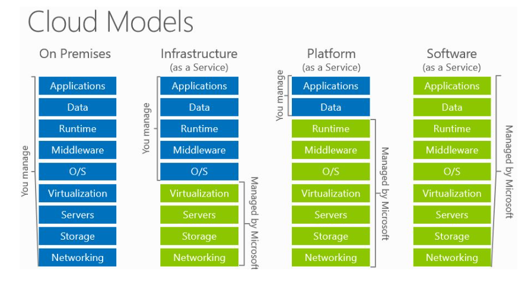
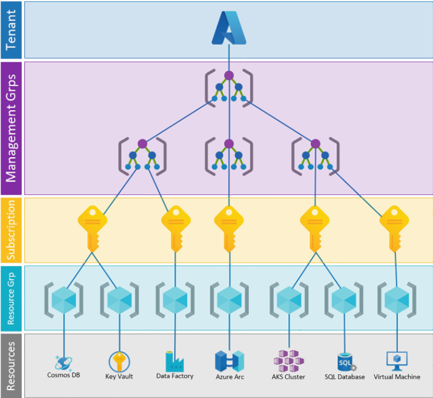
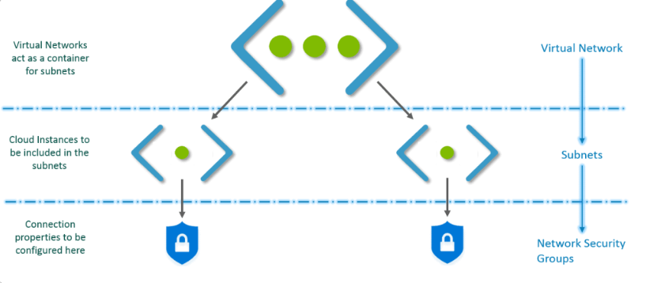
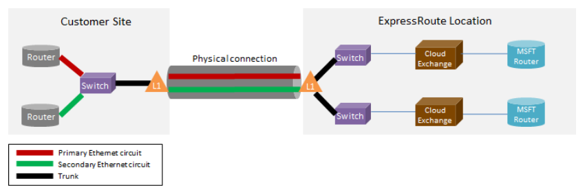

### AZ-900

- **Cloud** = Rent a Fast, Global, Reliable, Secure Service with 'Pay as you go' for resources like Compute, Storage, Database

- **Scaling**: 2 Types-
	- (1) Verticle Scalling : Upgrade an existing machine (CPU, RAM..)
	- (2) Horizontal Scalling : Add more machines to share workload

- __3 Cloud Service Models__ :
	- (1) **Infrastructure as a Service (IaaS)**-
 	  	- Gets Networking + Servers + Storage + Virtualization<br>
		- Scenarios : (1) Lift-and-Shift Migration (2)Testing and Development
	- (2) **Platform as a Service (PaaS)**-
  		- Gets Networking + Servers + Storage + Virtualization + OS + Middleware + Runtime
		- Scenarios : (1) Build Cloud-based apps usiong built-in components (2) Analytics and Business intelligence
	- (3) **Software as a Service (SaaS)**-
   		- Gets Networking + Servers + Storage + Virtualization + OS + Middleware + Runtime + Data + Application
		- Scenarios : (1)Email and messaging - Team, Outlook (2) Productivity applications- Word, Excel, PPT (3) Finance and expense tracking tools
	- (4) __Function as a Service (FaaS)__ : Instead of managing computers, manage Functions (a part of software)

- 3 **Cloud Deployment Models**:
	- (1) __Private Cloud__ : Pro: Direct control of Resources and Data + Cons: More Upfront Investment + Different from On-Prem as uses virtualization for on-demand compute resources and can be off-premises. 
	- (2) __Public Cloud__ : **Pro:** Get started quickly with minimum investment, easy to scale + **Cons:** no access to datacenter and hardware
	- (3) __Hybrid Cloud__ : Use sensitive data on Private-Cloud and use analytics from Public-Cloud
	  - **Pro**: __"Cloud Bursting"__ : If privet-cloud hits capacity, temporarily move to Public-Cloud.
 
	- (4) __Multi-Cloud__ : Different Cloud services from Different vendors to avoid vendor lock-in
	
-  __Types of Cloud-Engineers__:
	- (1) __Cloud Architect__ : Design Cloud Infrastructure based on business requirement
	- (2) __Security Engineer__ : Ensures data-privacy and technical security requirements for business
	- (3) __DevOps Engineer__: Maintain Infrastructure through code and ensure reliability, scalability and availability through Automation.
	
- Top 3 Cloud Service-Provider => AWS-2006, GCP-2008, Azure-2010

----------------------------------------------------------

- __Resource__
  	- Purchased Service like VM, DB, Web-Hosting
	- resources stay inside "Resource-Group"

- __Resource-Group__
  	- Logical grouping to hold related resources -> Lifecycle, Policy, permissions

- __Azure Resource Manager (ARM)__
  	- Centralized management layer for resources and resource-groups
	- Check Priveldge against Active-Directory for any Creation-Managemenmt-Deletion

- Created 1 Virtual machine in Azure -> In Deployment details, it created 4 Resources.

---
### Storage Services:
- __Azure Storage Tiers__ -> (1) Hot (2) Cold (3) Archive

	- (1) __Azure Blob (Binary Large OBject) storage__ -> text, image, video
	- (2) __Azure Data Lake Storage__ -> Historical data is any information
	- (3) __Azure Files__ -> file shares in the cloud accessible via the industry standard SMB protocol. 
	- (4) __Azure Backup Restore__

- __Redundacy of Storage Account__: LRS (Locally Redundant), ZRS (Zone-Redundant), GRS (Geo-Redundant), GZRS (Geo-Zone-Redundant)
 - 7 Capabilities : like Custom Domain, Static-website,Security, Front door and CDN Profile.
---
### Data-Processing:
- Real-Time Processing vs Batch Processing
- ETL (Extract->Transform->Load) process
- Processing Tools in azure : 
	- (1) __Synapse Analytics__ : Part of MS-Fabric, 
	- (2) __Stream Analytics__ : real-time data access, essential for immediate insights such as fraud detection in bank, dynamic pricing in stock market
	- (3) __Databricks__ : unified env for data engineering, analytics and ML
	- (4) __Data Factory__ : create schedule and orchestrate data workflow to streamline ETL process
	- (5) __HDInsight__ : managed service for data-processing. Can run on Hadoop, Spark, kafka

---
### Azure Security Center:
- __Azure Policy__ : enforce organization wise standards
- __Azure BluePrints__ : consistent deployments + blueprints to meet GDPR Requirements
- __Data-Protection & Compliance Tools__ => Encryption, Access Control (RBAC), Key Vaults, Azure Information Protection
- __Network Security__ => DDoS Protection, Azure Firewall, Network Security Groups (filter inbound/outbound traffic)
- __Managing Security__ => Sentinel (tool to detect and manage threat + cloud-native security information and event management (SIEM) and security orchestration automated response (SOAR) service offered by Microsoft Azure.), Key Vaults (stores classified information like secrets, keys, and certificates), Azure Information Protection (helps govern and classify sensitive information) 

- **Azure Security Center** is more about active security management. It provides unified security management, actively monitoring your resources.

- __Reserved Instances__ => upfront commitment -> can reduce cost up to 70%
- __Spot Instaces__ => Low price + Buy Unused compute capacity at saving + ideal for interruptible workload with no specific end time. Spot instances provide low-cost virtual machine instances that are ideal for short-term workloads with flexible scheduling. They are not suited for long-term workloads as Azure will terminate the instance once Azure needs the capacity.
- __Azure Hybrid Benefits__ => allows to reuse on-prem licenses
---
### Azure Resource Manager (ARM):
- deploy and manages azure resources act as a central-management-tool
- __"Azure Monitor"__ : Full-stack monitoring
- __"Azure Automation"__ : Streamline workflows and minimize repetitive tasks. Based on PowerShell
- __"Azure Advisor"__ : Personalized cloud consultant
---

### Integration Strategies:
- (1) __Lift and Shift__ : "Rehost" workload to azure "without modification"
- (2) __Refactor__ : some modification to maximize cloud benefits
- (3) __Rearchitecting__ : redesign for miximizing cloud features and benefits
- (4) __Rebuilding__ : start new in azure for outdated apps needing overhaul

- **"Azure ExpressRoute"** provide links between private datacenter to Azure connections.
- **"Azure Migrate"**: offers complete migration solutions.  Azure Migrate provides a unified dashboard to streamline and guide the migration process
- **"Azure Site Recovery"**: offers disaster recovery solution as a service

-----------------------------------------------------------------------------------------------

- (1) __Region__
  		- Georaphical Area containing group of "Data-Centers"
		- Some services or virtual machine (VM) features are only available in certain regions, such as specific VM sizes or storage types. There are also some global Azure services that don't require you to select a particular region, such as Microsoft Entra ID, Azure Traffic Manager, and Azure DNS.

- (2) __Availability-Zone__
  		- seperate, physicallly independents data-centers within a Region. If one zone is down, then application/data can be accessed through another zone.
		- To ensure resiliency, a minimum of three separate availability zones are present in all availability zone-enabled regions. However, not all Azure Regions currently support availability zones.

- (1) __Resource__
	- compute, network, Database, storage etc..
- (2) __Resource-Group__
	- Logical container (or virtual folder) of Resources.
	- Resources belongs to ONLY 1 Resource-Group AT A TIME, "But" they can moved from one Resource-Group to another.
	- Resource-Group CANNOT be nested.
- (3) __Subscription__
  	- Organize Resource-Groups + Simplify the Billing Process
  	- Membership to access Cloud resources
	- Every Subscription is linked to "Azure Account"
- (4) __Azure-Account__
  	- Allow to use and manage azure resources 
- (5) __Management-Group__
  	- (Optional Layer) Organize and Control Multiple Subscriptions
  	- Management-Group CAN BE nested upto 6 levels  (excluding the root and subscription level).


---					 
### Hierarchical Structure:
```text
Azure Account -->
      Management groups (optional) -->
                            Subscriptions -->
                                   Resource Groups -->
                                                  Resource
```
--------------------------------
### Azure Storage Services:
- (1) __Blobs__:
  	- Binary Large OBjects
	- store large ammount of "unstructred data" like doc, image, video etc.
	- Use-cases : 
		- (1) storing files for wide-spred access 
		- (2) streaming video and audio content
		- (3) storing data for backup, disaster-recovery, archives
		- (4) direct delivery of images or content through web (Static website)
	- 4 Access Tiers for Blob Storage to optimize cost :
		- (1) __"Hot"__ access tier: best for "FREQUENTLY accessed data"
		- (2) __"Cool"__ access tier: best for "INFREQUENTLY accessed data" like customer-invoices
		- (3) __"Cold"__ access tier: best for "RARELY accessed data" like customer-invoices like short-term backups
		- (4) __"Archive"__ access tier: best for "Archiving data for long term" like long term backups
- (2) __Files__:
  	- Organize file spaces in cloud which can be accessed from BOTH ( cloud + ON-PREM) devices
	-  Use-caases :
		- (1) When a shared storage is required for multiple users or applications
		- (2) cross-platform access is needed (as can be accessed from any OS)
		- (3) Centralized cloud location for file-colaboration
		- (4) need to share application data between different components of an application
- (3) __Queues__:
  	- Digital Message Service in cloud to enable communications between various components, programs and applications.
	- Prevent information loss
	- Messages are stored, creating a queue of instructions
- (4) __Tables__:
  	- NoSQL Datastore (i.e. store and retrieve data  flexible and SCHEMA-LESS way) 
	- faster access as data stored in KEY-VALUE PAIRS
	- Cost-effective and simple to manage
- (5) __Disks__:
  	- also known as "Azure Managed Disks"
	- provides SCALEBLE and SECURE PERSISTENT STORAGE to VMs
	- Provide storage spance to VM for OS, application and data
																									
```text
NOTE : Except Disks, every other service requires "Storage Account". Storage-Account is virtual conatainer of your data to Organize, access and secure data in azure cloud.
In order to avoid unintentional removal of wrong resources, Azure prompts for confirmation of the resource name.
```

---
### Storage Redundancy:
- (1) __Locally Redundant Storage (LRS)__: 3 copies in the same data-center from the primary region
- (2) __Zone Redundant Storage (ZRS)__: 3 copies across three data-centers in an Availability-Zone from the primary region
- (3) __Geo-redundant storage (GRS)__: LRS + copy data to secondary region in LRS for extra protection.
- (4) __Geo-zone-redundant storage (GZRS)__: ZRS + + copy data to secondary region in ZRS for extra protection.
---
### Data Migration Options:
- (1) __Azure Migrate__:
  	- Real-Time
	- Service to move data from On-prem to Cloud
- (2) __Azure Databox__:
  	- Conventional, Physical Migration
	- For Companies with Large Volume of Data
	- (1) Azure sends "Azure Data box" -> (2) Comapany copies large volume of data in "Azure Data box" -> (3) Comapany send back box to Azure -> (4) Azure restore all data into cloud
---					
					
### File Operations:
- (1) __AzCopy__:
  	- Command line tool for file upload/download/manipulation + used for storage accounts and Local resources 
	- works with other Cloud Providers also
- (2) __Azure Storage Explorer__:
  	- same functionality as AzCopy but "UI Inteface" to handle "Files" and "Blobs" 
- (3) __Azure File Sync__:
  	- sychronize files across different computers and azure cloud -> Most recent file can be accessible from any location


```text
Note : Javascript files can be edited directly in cloud if needed. But not JQuery/Excel/Word
```
--------------------------------

### Azure Compute Services:

3 Categories of Compute Services :
- (1) __Infrastructure as a Service (IaaS)__:
  	- Provide virtualized computing resorces over internet
	- Need not to Manage Hardware + Only manage OS, Software Components, DB
- (2) __Platform as a Service (PaaS)__:
  	- Need not to Manage Hardware,OS and Software Components, DB setup + Only manage DB admin
- (3) __Serverless (Azure Functions/Containers)__:
  	- Users focus main only on writing code
	- codes get executed on resoonse of an events
	- No need to manage infra
	- __"Azure Container Instances"__ => Quickly run container to test/run application
	- __"Azure Kubernetes Service (AKS)"__ => Container Orchestration
--------------------------------
### Azure Networking:


- __VNET__:
	- Enbale Communication between Cloud Resources
  	- Has PRIVATE IP addresses (private endpoint) and can be sub devided into SUBNETS
	- Resources within VNET can communicate to each other and  are NOT reachnabe from Internet
	- Resources to access Internet, need "Public endpoint" BUT some resources like WebApp DON'T REQUIRES PUBLIC IP to access internet.
```text	 
		+-----------------------------------------------------+
		|              VNET (10.1.0.0/16 )                    |
		|                                                     |
		| +--------------------------+  +------------------+  |
		| |        Subnet 1          |  |     Subnet 2     |  |
		| |		10.1.1.0/24  |  |   10.1.2.0/24    |  |
		| |                          |  |                  |  |
		| |   +------------------+   |  |                  |  |
		| |   |   [ VM / App ]   |   |  |                  |  |
		| |   +--------||--------+   |  |                  |  |
		| |            ||            |  |                  |  |
		| |            \/            |  |                  |  |
		| |      +------------+      |  |   +------------+ |  |
		| |      |    SQL     |      |  |   |    SQL     | |  |
		| |      +------------+      |  |   +------------+ |  |
		| |  (Private Endpoint)      |  | (Public Endpoint)|  |
		| +--------------------------+  +------------------+  |
		+-----------------------------------------------------+
```
- __VNET PEERING__:
	- Enable connection between resources present in different VNETs
	- Bypass Public internet and usage microsoft's network
	- Traffic is Private
			 

- __VPN GATEWAY__:
  	- Connectivity between On-Prem and Cloud using Internet
	- Use Internet but data is encrypted
			

- __Azure ExpressRoute__:
	- Connectivity between On-Prem and Cloud using DEDICATED PRIVATE CONNECTION
   	- Best for connecting Offices' Data center to Azure Cloud with secure connection without internet



- __Azure DNS__:
  	- azure offers own DNS service
  	- Not for internal use


------------------

### Azure Virtual Machine:

- 2 Types of VM Characterstics :
  - (1) VM Properties : OS, Number of Processor, Memory
  - (2) VM Components : Disks, Public IP, NIC Card

- __Scale-Set__:
  	- Deploy a set of Indenticle VMs
    - Can choose highest number of VMs
		  
- __Availability-Set__:
  	- VM is distributed across multiple Racks inside a Datacenter.	  

-------------------

### Hosting Application on Azure Cloud:

- __Azure App Service__:
  	- Fully managed serive for Building + Deploying + Scaling web-apps
	- web-apps/API-apps/mobile-apps/web-jobs
	- Provides "automatic scaling"
						
- (1) __Azure Web App__ = Suited for hosting variety of web-sites with capability to migrate
- (2) __API app__ = allows software applications to communicate with each other using API (API Creation)
- (3) __Web Jobs__ = serves as "background tasks or scripts" and scheduled activities
- (4) __Mobile app__ = used to run "backend services" like authentication/data-sync/push-notification for mobile application
 

-------------------

### Azure Directory Services:
- Manage user identities and access
- __Microsoft EntraID__ = AD on azure cloud

- (1) __Microsoft EntraID__:
  	- Single set of Login credentials for services
	- Use-cases : 
		- (1) Authentication
		- (2) SSO
		- (3) Application management
		- (4) Device management and access policies
	- Improves colaboration using external identities (no need to create new user account)
	- In Hybrid-set up, AD and EntraID can work together and share users, computers, groups and their properties
						
- __AD structure__ = User/Computer/Group (Group = characteristics or permissions)

-------------------

### Azure Identity Service and Access Control:

- __Authentication__ = is the process of verifying the identity of an individual, service, or device by presenting credentials to prove who they are.
- __MFA__
- __"Windows Hello for Business"__
  	- Ideal for individuals with Windows Computer
    - User can access computer using - Fingerprint, Face, Pin-code
- __"Microsoft Authenticator"__ app = Password-less way (Pin code/fingerprint) - Mobile app which offer MFA
- __"FIDO2"__ security keys = secure and "password-less" authentication by using "USB-device"

- __Microsoft Entra ID__:
  	- Authentication with (i) Password (ii) Passwordless (iii) MFA 
	- can control resource access (conditional access) based on (i)User (ii)Location (iii) Device	-> can (i)allow (ii) deny (iii) enforce MFA.
	- Ennforce MFA based on - (i) Roles (ii) Location (iii) Network

------------------

### Azure Permission model:
- __Role__ = Collection of Permissions (action an entity can perform on azure resources) like "Contributor" role
- Microsoft Entra ID offers 2 models to manage access :
  - (1) __Directory Role__:
    - Identity and Access management within organization
	- NOT RELATED to managing Azure Resources
	- Used for - Admin tasks related to User-accounts/Groups/Directory settings
	- (2) __RBAC__:
    	- Manage access to azure resources
		- Controls who can do what within - Subscription, Resource-Group, Individual resource
		- RBAC Inherintence
    		- Subscription -> Resource-Group -> Resource
			- roles will be inherited to lower in hirerachy from top "until removed explicitly" 
-------------------

### Azure Cloud Security:
- using Data-encryption + IAM + Network Security + Compliance adherence + Detect and respond Security incidents
- __Responsibility__ = shared between cloud service-provider and users
- (1) __"Zero trust security model"__:
  - assumption of potential breach by considering each request from unindentified place			   
  - __zero trust EXPLICIT VERIFICATION__
  - __zero trust LEAST PRIVELGE Access principle__
  - __zero trust ASSUME BREACH principle__
- (2) __"Defense-in-depth"__
  - employs multiple level of defense __to block the progress of attack__
  - Layered approach = central data is protected by protective layers
  - Physical security -> Identity & access -> Perimter -> Network ->  Compute -> Application -> Data 
- (3) __"Microsoft Defender for Cloud"__
  - Monitoring tool for security posture management and threat protection
  - Assess + Secure + Defend
								 
----------------------

- __Azure Service__ = Set of features or functionalities + Integrated Components
- __Azure Resource__ = Specific rpoduct or object "of a service" + Manageable items


### Azure Management & Governance:
- (1) __Cost Management__ :
  - Use-Case : Pro-actively manage costs to avoid going over budget
  - Typical cost-structure is  "Pay-as-you-Go" + Azure-marketplace for 3rd-party-Services
  - Cost management Tools =
    - (1) Follow-up of resource and application cost
    - (2) Setting up budget, spending-limit and overbudget-alerts
    - (3) __Cost analysis__ (monthly cost obverview report)
- (2) __Resource Management__ :
  - Use-Case : Manage (Cerate, Control & Organize) resources supporting business application
  - __Feature__ :
    - __Infrastructure as Code (IaC)__ :
      - undelines how resources are automated in azure.
      - Manage resourcces using staructured codes and automation tools rather than Manual Process.
      - IaC uses Configuration files.
      - Benfits of IaC:
        - (1) Consitency and Reproducibility
        - (2) Easier to documenmt and Share
        - (3) Less error-prone
	- __Resource Tags__ :
  	  - Metadata as "Name:Value pair" to organize resources
      - Label resources (e.g per project)
      - Enable tracking of resources (e.g. follow-up cost)
	  - For "business critical apps" :  Tag as "type:Critical"
	- __Resource locks__ :
	  - Metadata to organize resources
	  - Prevent modification to resources
	  - Prevent deletion of resources
	  - Permanent or Temporary (e.g. durin maintenance)
	  - For "business critical apps" :  put resource lock on deletion where Tag is "type:Critical"
			
- (3) __Policy and Standards Implementation__ :
  - Use-case : Ensure data-protection standards are implemented and enforced
  - __Governance__ = Guiding Principles [(1) Accountability (2) Transparency (3) Security ] for operating responsibly
    - Typical governance tasks in azure -
      - (1) Setup specific governance policies
      - (2) Log user actions to provide and audit trail
      - (3) Document and Report fulfillment of regulatory obligation with help of azure
      - (4) Azure can take different governance requirements based on region
  - __Compliance__
    - Adherence to applicable industry standards, laws and regulations
    - Typical Compliance tasks in azure -
      - (1) Enforce the use of data-sensitivity-labels
      - (2) Requires encryption of sensitive data
      - (3) Azure can take different compliance requirements based on region
- (4) __Monitoring__ :
  - Monitor the performance and availability of your application and resources
  - Typical monitoring taks in azure :
    - (1) Identify potential issues with resources or application
    - (2) Follow-up on usage and cost
    - (3) Analyze log history to plan for future needs
  - Azure provides capability to monitor an issue and optimoze process "proactively"
  - For "business critical apps" to reduce downtime: (1) Proactively detect issue (2) Monitor usage traffic to plan new resource capacity
-----------------------
### Planning and Cost management:
- Factors that affect cost :
  - (1) __Consumption__ = Using resouce leads to cost (Pay-as-you-go) [Note : Just Creating a resource DOESNOT cost]
  - (2) __Subscription Type__ = Depending upon type as there may be allowances or free products
  - (3) __Resource-type and Settings__ = Resources can have 'higher-tiers' that increase costs
  - (4) __Azure region__ = Regional pricing differ and data transfer to other regions are more expensive

 - __Strategies to reduce Cost__ :
   - (1) Maintenace and Monitoring Process inplace to find underused or iverused resources.
   - (2) Other Pricing Models : short-term flexibility vs long-term engagement + If there is a high and stable need for resources, other pricing models with fixed costs might be more interesting. Examples are Azure Reservations, to reserve resource usage up-front, or Enterprise Agreement, which has volume licensing.
   - (3) Geography : minimize inter-regional data-transfer
   - (4) Cost-management-Tools : cost estimation, budget and alerts
     - __3 Tools used in azure for cost management__ :
       - __(1) Pricing Calculator__ :
         - Estimate cost (along with Cost per Month) of a specific resource configuration in azure
         - Freely avialble
         - Help to estimate cost of single resource or for a specific combination
         - it has some 'Template scenario' e.g. big-data analytics set-up
	   - __(2) TCO Calculator__:
     		- Compare the total cost of on-prem infra with the same configuration in azure cloud.
        	- Total Cost of Ownwership (TCO) including hidden costs like operating cost.
			- Freely available
     		- Typically used to support azure migration
		- __(3) Cost Management__:
       		- Provide users with insights and controls to monitor, analyze and optimize cost.
			- central hub in Azure for all things cost related
			- allows to set-up budgets and cost details
			- Manage billing options and invoices
			- API for exporting cost details to external systems
			- To analyse cost specific __"Cost Analysis" tool__
				- Cost Analysis tool
       				- Used for ad-hoc cost exploration with custom visualizations and filters
					- can also do __"Cost Forecast"__
					- for more advance analysis, can be integrated with Power-BI
																	 
										  
	- __Cost management tasks in azure__ :
		- (1) Compare costs for running on-prem infrastructure vs Azure cloud
		- (2) Always estimate cost for provisioning new resource in azure. Azure gives "cost-per-month" when creating VM and choosing its size.
		- (3) Analyze costs 
		- (4) Setup budgets and automatic alerts
		
---------------------------------

### Governance and Compliance Implementation:

- __Service Trust Portal__:
  - Details Microsoft's Security, Privacy and Compliance practices related to Azure cloud environment.
  - resources related to compliance standards and best practices.
  - Informs you about the controls and processes Microsoft applies for the protection of cloud data.
  - Provides resources and documentation on risk-assessment and compliance best practices includes certifications like ISO and GDPR.

- __Microsoft Purview__:
  - Comprehensive data management service for azure and other microsoft products.
  - Combination of previous Azure Perview with Microsoft 365 Compliance.
  - Specific focus on to managing data assests like
    - Data Security
    - Data governance
    - Data risk & compliance
  - Use-cases :
    - (1) "Data Catalog" feature
      - centralized overview of all data assets and their metadata.
      - Used to document which data is collected, where it is stored, and who has access to it. 
	- (2) "Data Map" feature = provide visual representation (mapping) of  data flows through systems, applications and other company processes allowing to check data origin and destinations
	- (3) Data labeling, data classification and 'metadata enrichment'
	- (4) supports 'data transfering and sharing' with other users.

  - __"Microsoft Purview's Compliance Manager"__:
    - shows Dashboard to assess current compliance status with a specific set of regulations.
    - current compliance status summarized with a scoring system.
    - generate recommendations to improve compliance  and reduce risks

		
-------------------------------------
### Azure Governance and Compliance Tools:

- (1) __Azure Policy__:
  - Enforce standard and best practices by defining and applying rules and policies to resources
  - Used to set rules and standards to resources
  - Rules set by Azure-Policy can be set at any level and inherited automatically to sub-level. (i.e. resources takes policy from resource-group)
  - allows automatic remediation : e.g. applying missing tag
  - Azure Policies can be goruped  into "Initiatives" :
    - __Initiatives__:
      - Group of related policies for a larger goal
      - this can be User-defined or built-in for common scenarios or regulations like HIPPA/HITRUST
      - may contains following following policies like -
        - MFA should be enabled
        - There should be more than one owner assigned to a subscription
        - Automatic check for missing members in the Administrators group
- (2) __Azure Blueprints__:
  - Standardize deployments, replicate configurations from existing environments.
  - standarized new cloud subscriptions or deployments
  - In doing so, preserve the Link between blueprints (what should be deployed) and resources (what was deployed)
  - supports "versioning" : kepp track of updates  or revert back to a previous working version
  - Azure Blueprints consists of components called "Artifacts".
    - __Artifact__:
      - each artifact contain parameters that can be specified
      - configuration can be done directly in blueprint or while at deployment
      - Example of artifacts :
        - Role assignment
        - Policy assignment
        - Resource group configuration
		- Predefined resource templates
        
- Example Use-Case : Network-Security : Disabling Public internet access based on specific rules :
  - with "Azure Policy" : implement a set of rules that block or restricts public internet access
  - with "Azure Blueprints" : assign above policy as an artifact to automatically include it in new deployments
	
-------------------------------------
### Interacting with Azure environment:

- 5 ways to interact with Azure environment :
- __(1) Azure Portal__:
  - GUI and Dashboards to view  and manage azure services (User = Anyone)
  - Used to build, develop, monitor cloud deployments and web-apps
  - Create custom dashboards to organize and view resources
  - Configure accessibility options
- __(2) PowerShell__:
  - Execute scripts and functions for (automatic) management of Azure resources (User = IT Team)
  - Can be used to input commands for management of Azure resources
  - Commands can be used one-off or in a script for automation
- __(3) Azure CLI__:
  - Execute scripts and functions for (automatic) management of Azure resources (User = IT Team)
  - equivalent to PowerShell tool but uses "BASH" syntax command 
- __(4) Azure Arc__:
  - Used to connect to external resources and manage resources of azure as if they were internal part of it(User =  IT Team)
  - Example : SQL server, Kubernetes server, VMs, On-prem servers
  - through Azure-Arc, Azure can act as a SINGLE PORTAL for HYBRID CLOUD implementations.
- __(5) Azure Mobile__:
  - Used to manage and monitor resource on the go (User = Anyone)
  - available for both Android and iOS
  - CANNOT do all azure tasks
  -  Used to manage and monitor resource on the go
----------------------------------

### Azure Resource Management:

- (1) __Resource-Group__:
  - Grouping of related resources
  - Can be managed collectively
  - Resource tags and properties like access roles can be assigned at a group level.
- (2) __Azure Resource Manager (ARM)__:
  - Resource management layer in azure
  - can do takss like create, update, delete resources
  - handle access control and  resource properties
  - ARM has 2 important features :
    - __(1) Resource Providers__ = supplies and manages specific type of resources.
      - Example - Microsoft Compute for virtual machines
      - ARM relies on Resource Providers to execute resource taks
	- __(2) Templates__ = To reuse a specific resource configuration
      - Define and Configure resources (e.g. resource groups) for repeated use
      - these Templates are Modular, whi means seperate templates can be combined for more complex deployments
      - can integrate with Azure DevOps for automation with pipelines
      - ARM templates follow IaC e.g. supports versioning
      - Azure provides built-in templates for common resource deployment
      - can create own template using 'Bicep' syntax
      - Example : Define auto-scaling in resource like VM so they automatically adjust during high demand + define adjustable parameter for  flexibility
											
														
----------------------------------
### Azure Monitor:

- To setup monitoing, we follow __"Workflow"__
  - (1) __Data Collection__: 2 types of data
    - (1) __Metrics__ = Numerical data related to performance of resources, applications and services
      - Example : Memory usage
	- (2) __Logs__ = event data related to actions by users in azure
      - Example : Chnages made by a particular user
									 
  - (2) __Analyse and visualize data__:
    - To evalaute how the resources and applications are performing and to identify possible issues.
      - (1) __Metrics__ : calculate stats and plot chart over time
      - (2) __Logs__ : use quarries to apply specific filters or create tables or list
	- __Analysis tools__ :
      - (1) Azure monitor built-in tools
      - (2) External tools like Power-BI
  - (3) Proactive monitoring and alerts
    - set up tests and alerts
    - set up business-rules to automatically handle specific issue ( email-notification or running a script)
    -  Automation and ML facility is also available.

- __Monitoring Tools__ : 3 important monitoring tools in Azure 
- __(1) Azure Monitor__:
  - __"Application Insights"__:
    - Used for APM
    - Detect, Dignose and address issues in web applications
    - Provide insight into Performance, availability  and usage
    - Typical tasks :
      - View and visulaize performance metrics
      - Find Errors and Bugs using 'Smart Detection'
      - Set up live and automatic monitoring
  - __"Log Analytics"__:
    - Used for System Performance management
    - Resources, services and infrastructure
    - can be used in conjuction with Application Insights for applications
    - Use-cases :
      - Tracking the performance of resources
      - Troubleshooting and  diagnostic
      - Capacity planning
      - Ensuring security and Compliance
  - __"Alerts"__:
    - Used for setting up automatic alerts for specific conditions
    - Alerts based on specific metrics or a combination
    - allow to setup notifications via various channels
    - alert's notification can be eascaleted if problem persists.
    - automatic remediation is also possible
- __(2) Service Health__:
  - Used to check the current status of  Azure Cloud service in general -
    - Planned Maintenance by Microsoft that will impact your resources
    - Outages and incidents like Current regional outages of Azure services
    - Upcoming updates and changes like Changes to a specific feature in an upcoming update
- __(3) Advisor__:
  - Used for personalized __'recommendations'__ to optimize Azure resources :
    - (1) __COST__ = recommendations to reduce overall Azure spending
    - (2) __SECURITY__ = identify possible security issue
    - (3) __PERFORMANCE__ = recommendations to improve performance and responsiveness
    - (4) __HIGH VAILABILITY/RELIABILITY__ = recommendations to ensure availability and resilience. Advisor might for example, suggest implementing geo-redundancy, which means that critical data is replicated across multiple regions as protection against regional outages.
    - (5) __OPERATIONAL EXCELLENCE__
      - apply best practices for efficient resource management and deployment
      - Advisor will NOT implement recommendations automatically. You need to review each recommendation and take neccessary actions
----------------------------------
### Miscellaneous Notes :

- __Service endpoints__ are used to expose Azure services to a virtual network, providing communication between the two. 
- __ExpressRoute__ is used to connect an on-premises network to Azure. 
- __NSGs__ allow you to configure inbound and outbound rules for virtual networks and virtual machines. 
- __Peering__ allows you to connect virtual networks together.

- __A local network gateway__ is used to define the on-premises network details, such as IP address ranges and the VPN device public IP address, when configuring a Site-to-Site (S2S) VPN. 
- __Network security groups (NSGs)__ control traffic flow, route filters are used with ExpressRoute,  
- __VNet-to-VNet connections__ connect Azure virtual networks rather than on-premises networks.

- __Azure Files__ offers fully managed file shares in the cloud that are accessible via industry-standard __SMB and NFS protocols__.

- __Conditional Access__ is a feature that Microsoft Entra uses to allow or deny access to resources based on identity signals, such as the device being used. 
- __SSO__ enables a user to sign in one time and use that credential to access multiple resources and applications from different providers. 
- __MFA__ is a process whereby a user is prompted during the sign-in process for an additional form of identification. 
- __Hybrid identity solutions__ create a common user identity for authentication and authorization to all resources, regardless of location.

- A __defense in depth strategy__ uses a series of mechanisms __to slow the advancement of an attack__ that aims to gain unauthorized access to data. 
- The __principle of least privilege__ means restricting access to information to only the level that users need to perform their work. 
- A __DDoS attack__ attempts to overwhelm and exhaust an application's resources. 
- The __perimeter layer__ is about protecting an organization's resources from network-based attacks.

- __Microsoft Entra Connect__ syncs user identities from an on-premises Active Directory Domain Services (AD DS) domain to Microsoft Entra. 
- __Microsoft Entra Connect__  allows you to use features such as single sign-on (SSO), MFA, and self-service password reset (SSPR) in both systems. 
- __SSPR__ prevents users from using known compromised passwords.


- __Microsoft Entra Domain Services__ provides managed Active Directory Domain Services (AD DS) capabilities without requiring customers to deploy or manage domain controllers. 
- __Microsoft Entra ID__ is a cloud identity service that does not provide AD DS functionality, managed identities are used for application authentication
- __Azure App Service__ is an application-hosting platform.

- __Azure Reservations__ offers discounted prices on certain Azure services. Azure Reservations __can save you up to 72 percent__ compared to pay-as-you-go prices. To receive a discount, you can reserve services and resources by paying in advance. 
- __Spending limits__ can suspend a subscription when the spend limit is reached.

- By using __ARM templates__, you can describe the resources you want to use in a declarative JSON format.

- __Cloud Shell__ is an interactive, browser-accessible shell for managing Azure resources.
- The __Azure portal__ can run on devices that have the Android operating system installed. The browser can be any type, such as Internet Explorer 11, Chrome, Firefox, or Safari (all the latest versions). When you visit the portal, you will see Cloud Shell. __Users can then access Bash and PowerShell from within Cloud Shell.__ You can use Bash and PowerShell to create Azure virtual machines.

- After an outage, __Service Health__ provides official incident reports called root cause analysis (RCA), which you can share with stakeholders.

- __Azure Monitor__ is a platform that collects metric and logging data, such as CPU percentages. The data can be used to trigger autoscaling.
- __Application Insights__ is a feature of Azure Monitor that allows you to monitor running applications, automatically detect performance anomalies, and use built-in analytics tools to see what users do on an app.
---
